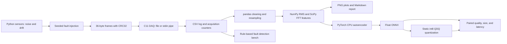

# embedded-sensor-ai-lab

[](https://github.com/hamza2829/embedded-sensor-ai-lab/actions/workflows/ci.yml)

A small measurement chain in simulation: seeded sensors, a C11 acquisition executable,
Python measurement analysis, and a CPU autoencoder exported to float and int8 ONNX.
No hardware and no real lab measurements are used.



## Measured results

<!-- RESULTS:START -->
Measured by [GitHub Actions](https://github.com/hamza2829/embedded-sensor-ai-lab/actions/runs/42526249710) on source commit `7bc986e1d9848cae7ae2609616eb4e3235fb89b6`.

**50 tests passed**: 14 CTest cases and 36 pytest cases; none skipped.

Python statement and branch coverage: **98.51%**. C line coverage: **99.00%**; C branch coverage: **88.50%**.

The fault bench detected dropped frames, bad CRC, stuck sensor, and spikes, with no alerts on its clean control.

| ONNX model | File bytes | Median latency | p95 latency | Precision | Recall | F1 | ROC AUC |
| :--- | ---: | ---: | ---: | ---: | ---: | ---: | ---: |
| float | 10686 | 5.849 us | 6.069 us | 0.9978 | 0.9014 | 0.9472 | 0.9719 |
| int8 | 11159 | 8.312 us | 8.693 us | 0.9979 | 0.9082 | 0.9509 | 0.9718 |

Int8/float size ratio: **1.044**. Int8/float median latency ratio: **1.421** (above 1 means slower). Training took **0.80 s** on this hosted CPU.

Evaluation: **1280 feature windows** from separate seeded runs. Both models use the same float-calibrated threshold `0.396737`. Quantization caused **1 newly wrong decisions** and **8 newly correct decisions**; **9 total disagreements**.

| Injected class | Float alarm rate | Int8 alarm rate |
| :--- | ---: | ---: |
| current_step | 78.12% | 80.86% |
| normal | 0.78% | 0.78% |
| spike | 82.42% | 82.42% |
| stuck | 100.00% | 100.00% |
| vibration_shift | 100.00% | 100.00% |

For normal windows, alarm rate is the false positive rate. For fault windows, it is recall. Low amplitude faults may be missed by either model.

Cases where int8 loses a correct float decision:

- `current_step`, seed 22074, window 1: float score 0.416165, int8 score 0.395836.

Timing measures batch-one ONNX inference only, with one thread, 50 warmups, and seven alternating rounds of 500 calls per model. It excludes feature extraction and acquisition. Hosted x86 timing is not a microcontroller measurement.

Raw outcomes, confusion matrices, quantization details, seeds, and coverage are in [reports/final.json](reports/final.json). Per-run examples: [clean](reports/clean/measurement.md), [dropped frames](reports/dropped_frames/measurement.md), [bad CRC](reports/bad_crc/measurement.md), [stuck sensor](reports/stuck_sensor/measurement.md), and [spikes](reports/spikes/measurement.md). ONNX files, checkpoints, and coverage HTML are available in the workflow artifacts.

This section and the reports are committed after all verification jobs pass. That generated report commit does not trigger a new run; the source commit above identifies the code measured.
<!-- RESULTS:END -->

## Run

Python 3.11, a C11 compiler, and CMake 3.20 or newer. All repository verification during
development runs on GitHub Actions. No dependencies were installed on the user's PC.
The commands below can be run in a Linux development environment or CI runner.

```bash
cmake -S . -B build -DCMAKE_BUILD_TYPE=Release
cmake --build build --parallel 2
ctest --test-dir build --output-on-failure

python -m venv .venv
source .venv/bin/activate
pip install torch==2.6.0 --index-url https://download.pytorch.org/whl/cpu
pip install -e '.[dev]'

sensor-ai-lab simulate --seed 123 --samples 2048 --output runs/frames.bin
build/src/daq/daq --input runs/frames.bin --output runs/samples.csv --stats runs/daq.json
sensor-ai-lab analyze runs/samples.csv --stats runs/daq.json --output runs/analysis
sensor-ai-lab bench --daq build/src/daq/daq --output runs/bench
sensor-ai-lab train-export --daq build/src/daq/daq --output runs/model --epochs 60

ruff check .
pytest --cov --cov-report=term-missing
```

For pipe input, use `cat runs/frames.bin | build/src/daq/daq --input - --output runs/pipe.csv
--stats runs/pipe.json` on a single line. `--output -` writes CSV to stdout. Every Python
command supports `--help`. The C executable's argument order is fixed as shown above.
Acquisition returns nonzero on usage and I/O failures. Rejected frames are counted in
the JSON stats while acquisition continues. `bench` exits with an error if any expected
fault is missed or the clean control raises an alert.

Use **Actions > Embedded sensor AI CI > Run workflow** for the complete remote run.
Artifacts contain JUnit results, separate C and Python coverage, five measurement reports
with PNG plots and CSV features, both ONNX graphs, the PyTorch checkpoint, model metadata,
held-out normalized evaluation inputs, and the exact installed Python environment.

## Binary protocol and acquisition

All fields are little endian. Frames are exactly 36 bytes, without native struct padding.
The C decoder uses explicit byte decoding and `memcpy` for IEEE 754 float conversion.

| Offset | Bytes | Field |
| ---: | ---: | :--- |
| 0 | 4 | ASCII `SENS` |
| 4 | 2 | uint16 version, 1 |
| 6 | 2 | uint16 payload size, 24 |
| 8 | 4 | uint32 sequence, starting at zero |
| 12 | 8 | uint64 simulated source timestamp, microseconds |
| 20 | 4 | float32 temperature, degrees C |
| 24 | 4 | float32 vibration, arbitrary acceleration units |
| 28 | 4 | float32 current, amperes |
| 32 | 4 | CRC32 IEEE over bytes 0 through 31 |

CRC parameters: reflected polynomial `0xEDB88320`, initial and final XOR `0xFFFFFFFF`,
compatible with Python `zlib.crc32`. CRC verifies integrity, not authenticity.
The source clock advances exactly 5000 microseconds at 200 Hz. C adds an acquisition
UTC timestamp in nanoseconds using C11 `timespec_get`. It is a host receipt time,
not a real-time deadline or an estimate of sensor clock accuracy.

Header, CRC, finite-value, and range checks precede logging. Allowed sensor ranges are
temperature [-50, 150], vibration [-100, 100], and current [-50, 100]. Duplicate sequence
IDs and non-increasing source timestamps are rejected. Sequence gaps count missing
accepted IDs, including frames rejected by CRC or value checks. The initial sequence
is expected to be zero. Trailing partial bytes are counted and discarded. The protocol
assumes frame alignment; it does not recover from arbitrary inserted or removed bytes,
and it does not support sequence counter wrap within a run. A final dropped frame cannot
be inferred without an external expected frame count.

## Sensors, cleaning, and fault checks

The simulator produces noisy temperature with slow drift, vibration with 25 Hz and
62 Hz components, and current with 3 Hz variation and slow drift. Seeds control offsets,
phases, noise, and drift. Faults can drop full frames, corrupt CRCs, freeze temperature,
inject current and vibration spikes, create temperature drift, shift vibration frequency,
or step current. The transport bench checks the four required faults independently
against a clean control, through the actual C executable.

Acquisition counters flag missing IDs and CRC failures. Analysis flags 32 identical
consecutive readings as stuck and uses rolling median/MAD residuals with channel-specific
floors for spikes. These are transparent heuristic rules, separate from the learned model.
They are not calibrated for real instruments and do not establish universal detection rates.

Cleaning coerces nonnumeric and non-finite readings to missing values, rejects invalid
timestamps, and masks values outside the sensor ranges. pandas resamples on the source
clock and interpolates at most eight interior missing rows. Longer and edge gaps are
rejected. Spikes within valid sensor ranges remain visible as potential anomalies.
Features use non-overlapping 128-sample windows: mean, standard deviation, RMS, and a
SciPy periodogram peak per channel. Resampling to a lower rate averages bins; it is not
a general anti-aliasing filter. The report's plots use matplotlib's headless Agg backend.

## Model and comparison protocol

The autoencoder has 12 inputs and layers 12, 64, 4, 64, 12 with ReLU hidden activations.
Training uses normal examples only, Adam at 0.003, one CPU thread, seed 42, and 60 epochs.
Each seeded run has 256 samples and yields two non-overlapping windows.
Model inputs pass through the binary encoder, actual C collector, CSV reader, cleaning,
and resampling before feature extraction. Runs are batched with continuous transport
sequence IDs and timestamps while preserving window boundaries and original seed identities.
The workflow artifacts retain these acquisition logs. Direct simulated feature generation
is also available internally for unit comparison against the C path.
Training uses 256 runs with seeds 0 through 255; validation uses 64 runs with seeds
10000 through 10063. Feature normalization is fitted only on training data. The
checkpoint with the lowest normal validation reconstruction loss is exported.

The detector score is mean squared reconstruction error in standardized feature space.
Its threshold is the 99th percentile of float-model scores on normal validation data.
Both float and int8 use that same fixed threshold. Evaluation has 128 separate runs
per class, with start seeds 20000, 21000, 22000, 23000, and 24000 for normal, stuck,
current step, vibration shift, and spike classes. No evaluation samples are used for
training, normalization, quantization calibration, or threshold selection.

Static ONNX Runtime quantization calibrates on normal training inputs. The graph uses
QDQ signed int8 weights and activations with per-channel weight quantization; inputs,
outputs, and bias computation retain floating point. A checker confirms int8 tensors
exist. The float graph is checked against PyTorch within 1e-5 absolute output error.
Both exported graphs use the same CPU runtime, one thread, identical test inputs, and
the same threshold. Graph file sizes include graph metadata; shared preprocessing
metadata and the runtime binary are excluded. Latency excludes acquisition, feature
extraction, normalization, and anomaly scoring. It is not end-to-end embedded latency.

## Tests and CI

The C tests use a tiny in-tree assertion harness registered with CTest, plus a standard
library Python CLI integration check. No third-party C test framework is installed.
CMake enables C11, strict warnings, and optional GCC coverage. C tests cover CRC test
vectors, byte order, decoding, invalid values, headers, CRCs, sequence gaps, ordering,
truncation, empty input, timestamps, CSV/stats output, pipe input, and I/O failures.

Pytest covers deterministic simulation, every injected signal fault, binary encoding,
the real Python-to-C chain, all four required fault detections, a clean control,
resampling and interpolation, known RMS and FFT values, plot/report creation,
autoencoder loss reduction, real export and int8 inference, ONNX parity, comparison
metrics, calibration exhaustion, seed separation, and CLI dispatch/errors.
CI runs ruff, cppcheck, C build/CTest/gcovr, Python tests with coverage, the fault bench,
and the short training/export/comparison job. Coverage gates are Python 85% statements
and branches combined, C 85% lines and 70% branches. Results publish only after all pass.

## Limits

Simulated sensors only. No real hardware, no real lab measurements, no ADC drivers,
interrupts, DMA, RTOS scheduling, power measurement, calibrated instruments, or physical
units validation. The C collector is a host program with buffered file I/O, not firmware.
CSV is used instead of SQLite. The model sees handcrafted features, not raw waveforms.
The small synthetic distribution and a single training seed do not establish deployment
readiness. Weak faults can overlap normal noise. Normal-only quantization calibration
can clip unfamiliar activation ranges. Int8 can lose quality and can be slower on a
small model. Hosted x86 speed and ONNX graph size do not predict microcontroller latency,
RAM, flash, or energy. No claim of hardware deployment is made.

References: [ONNX Runtime quantization](https://onnxruntime.ai/docs/performance/model-optimizations/quantization.html)
and [PyTorch ONNX export](https://docs.pytorch.org/docs/stable/onnx.html).
