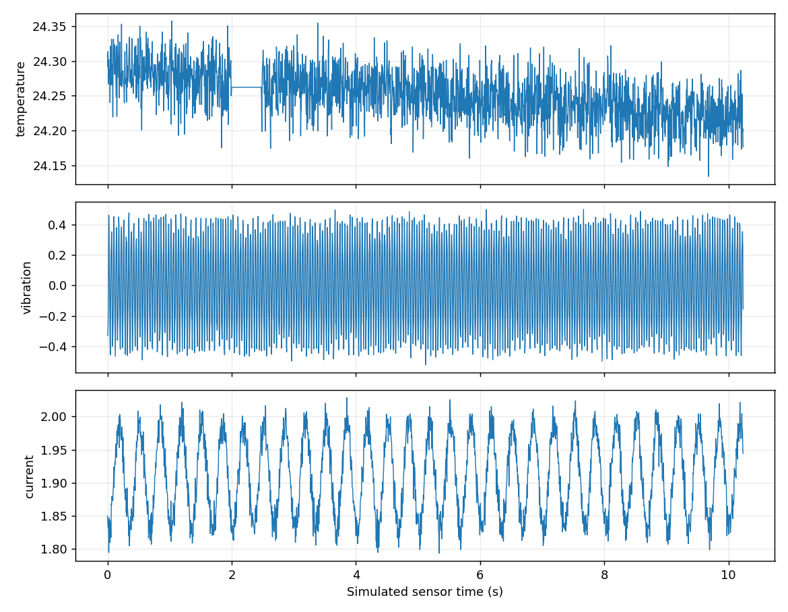
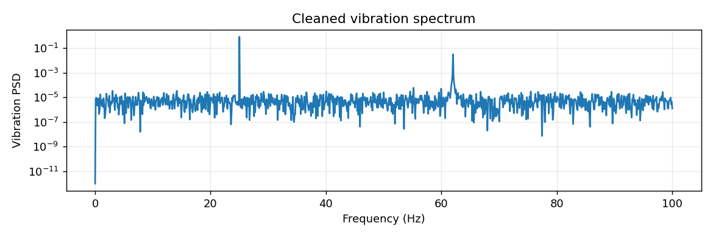

# Simulated measurement report

No hardware or real lab measurements.

Accepted frames: 2048. Feature windows: 16.

Cleaning: `{'raw_rows': 2048, 'resampled_rows': 2048, 'invalid_values': 0, 'interpolated_rows': 0, 'sample_rate': 200}`

Fault alerts: `{'dropped_frames': False, 'bad_crc': False, 'stuck_sensor': True, 'spikes': False}`

| Feature | Mean over windows |
| :--- | ---: |
| temperature_mean | 24.2515 |
| temperature_std | 0.0296077 |
| temperature_rms | 24.2515 |
| temperature_peak_hz | 45.2148 |
| vibration_mean | -5.49967e-05 |
| vibration_std | 0.288425 |
| vibration_rms | 0.288434 |
| vibration_peak_hz | 25 |
| current_mean | 1.91089 |
| current_std | 0.0589189 |
| current_rms | 1.9118 |
| current_peak_hz | 3.125 |

